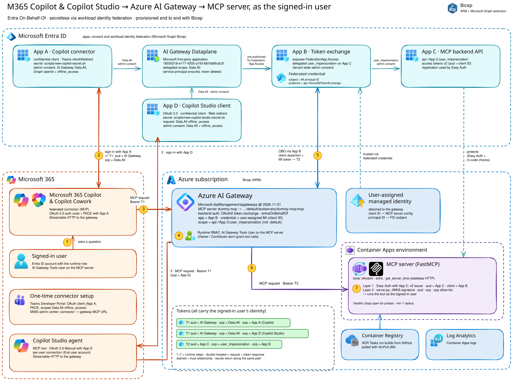
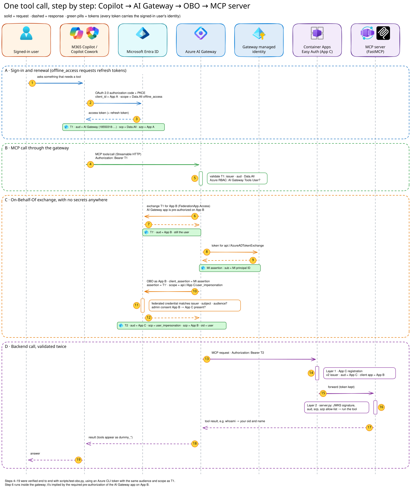

# Microsoft 365 Copilot / Copilot Cowork → Azure AI Gateway → MCP server, as the signed-in user

Bicep that provisions, end to end, in one `az deployment sub create`:

- **Microsoft Entra ID** ([Microsoft Graph Bicep extension](https://learn.microsoft.com/graph/templates/bicep/overview-bicep-templates-for-graph)):
  the MCP backend API, the gateway's *token exchange* app with a secretless federated credential,
  the Copilot connector client app, the Copilot Studio client app, pre-authorization, and
  tenant-wide admin consent.
- **Azure Container Apps**: a dummy FastMCP server protected twice by the backend app registration:
  Container Apps built-in auth (Easy Auth), then in-code JWT validation. The image is built by an ACR
  Tasks run from this repo during the deployment, so no local Docker is needed.
- **Azure AI Gateway** (`Microsoft.ApiManagement/aigateways@2026-11-01`): a gateway with a
  user-assigned managed identity, and an MCP server whose backend uses **Entra On-Behalf-Of** to
  call the container as the user.

> The Terraform version of this setup is on the [`terraform`](https://github.com/kostapetan/ai-gateway-end-to-end/tree/terraform) branch.



Step by step, one tool call looks like this:



The full walkthrough (token-by-token table and why each piece exists) is in
**[docs/architecture.md](docs/architecture.md)**. Diagram sources (`.excalidraw`) and PNGs are in
[`docs/diagrams/`](docs/diagrams/).

## What gets created

| Where | Object | Purpose |
| --- | --- | --- |
| Entra | **App A** `<prefix>-copilot-connector` | OAuth 2.0 client for the M365 Copilot federated connector: `Data.All` (AI Gateway), `openid`, `offline_access`, admin consent. Client secret: `scripts/new-copilot-secret.sh` |
| Entra | **App B** `<prefix>-token-exchange` | Identifier URI `api://<appId>`. Exposes `FederationApp.Access` (AI Gateway app pre-authorized). Delegated `user_impersonation` on App C with admin consent. Federated credential trusting the gateway's managed identity |
| Entra | **App C** `<prefix>-mcp-backend` | MCP backend API: `api://<appId>/user_impersonation`, v2 tokens |
| Entra | **App D** `<prefix>-copilot-studio` | OAuth 2.0 client for a Copilot Studio agent's MCP tool: `Data.All` (AI Gateway) and `offline_access`, with tenant-wide admin consent. Redirect URIs from `copilotStudioRedirectUris`. Client secret: `scripts/new-copilot-studio-secret.sh`. Skipped when `enableCopilotStudioClient = false` |
| Entra | AI Gateway Dataplane service principal (`18550318-…`) | Created if missing (upsert); a Bicep deployment never deletes it |
| Azure | User-assigned managed identity, attached to the gateway | Authenticates as App B (no secret) |
| Azure | AI Gateway + MCP server `dummy-mcp` | Backend auth: `oauth2` / `tokenExchange` / `entraOnBehalfOf` |
| Azure | Role assignment **AI Gateway Tools User** on the MCP server | Runtime permission to call tools (Owner and Contributor don't grant this) |
| Azure | ACR (image built by an ACR Tasks `taskRun`), Container Apps environment + app, Log Analytics | Hosts the dummy MCP server |

## Prerequisites

- Azure CLI signed in to the target tenant (`az login --tenant <tenant-id>`) as a user who can
  create app registrations and grant tenant-wide admin consent (we used Global Administrator), and
  who is Owner of the subscription (role assignments are created).
- Bicep CLI ≥ 0.36.1 (`az bicep upgrade`). `infra/bicepconfig.json` pins the Microsoft Graph extension
  (`microsoftgraph/v1.0:1.0.0`), which Bicep restores from MCR.
- Python 3, used by the end-to-end test.
- The image is built from `mcpServerSource`, which defaults to this repo's `main` branch. Point it at
  your fork or branch to deploy changes to `mcp-server/`.
- A region where AI Gateway is available, for example `swedencentral`, `westeurope`, `eastus2`
  (validated in `main.bicep`).

## Deploy

```bash
az deployment sub create --name aigw-obo --location swedencentral \
  --template-file infra/main.bicep --parameters infra/main.bicepparam
scripts/postdeploy.sh   # writes .vscode/mcp.json and prints the Copilot connector settings
```

Roughly 5–6 minutes. Outputs include the gateway MCP endpoint, for example
`https://aigw-….swedencentral-01.ai.gateway.azure.com/default/toolservers/dummy-mcp/mcp`.
Redeploying is idempotent: Graph resources are upserted by their keys (`uniqueName` for
applications, `appId` for service principals). The default `mcpImageTag` rebuilds the image on
each deployment.

## Verify the OBO chain

```bash
python3 scripts/test-obo.py
```

The script gets your delegated gateway token from the Azure CLI (`https://ai.gateway.azure.com/Data.All`,
the same audience and scope Copilot's token has). It then runs MCP `initialize`, `tools/list`, and
`dummy_whoami` through the gateway, and checks what the backend actually received:

```text
[3] initialize -> protocol 2025-11-25, server Azure AI Gateway
[4] tools/list -> ['dummy_echo', 'dummy_get_server_time', 'dummy_whoami']
[5] dummy_whoami -> { "username": "admin@contoso.onmicrosoft.com", "audience": "<App C>", "client_app_id": "<App B>", "scopes": "user_impersonation", ... }
[6] Gateway token sent straight to the backend -> HTTP 401

PASS  anonymous gateway call is rejected (401)
PASS  backend saw the signed-in user (oid)
PASS  backend token audience is the backend app
PASS  backend token was requested by the token exchange app (azp)
PASS  backend token carries the delegated scope
PASS  backend rejects tokens that bypass the gateway
```

## Connect Microsoft 365 Copilot / Copilot Cowork

Bicep creates App A and its consent. The Microsoft Graph Bicep extension can't create client
secrets, so the secret is a separate step. The Teams Developer Portal registration and the
connector are portal steps:

```bash
scripts/postdeploy.sh            # prints the values below (outputs.copilotConnector)
scripts/new-copilot-secret.sh    # adds a client secret to App A and prints it once
```

1. **Teams Developer Portal** (<https://dev.teams.microsoft.com/tools>), signed in to **the same tenant**:
   **Tools → OAuth client registration → New**. Paste the values without leading or trailing spaces.

   | Field | Value |
   | --- | --- |
   | Base URL | `baseUrl`, the gateway MCP endpoint. Must match the connector's Base URL exactly |
   | Restrict usage by org | My organization only |
   | Restrict usage by app | **Any Teams app** (binding a Teams app ID breaks MCP calls) |
   | Client ID / Client secret | `clientId` / output of `scripts/new-copilot-secret.sh` |
   | Authorization endpoint | `authorizationEndpoint` |
   | Token endpoint and Refresh endpoint | `tokenEndpoint` |
   | Scopes | `https://ai.gateway.azure.com/Data.All offline_access` |
   | PKCE | Enabled |

   Save, then copy the **OAuth client registration ID**.
2. **Microsoft 365 admin center** → **Copilot → Connectors → Gallery → Create a new connector →
   Connect to MCP server**. Set **Base URL** to the gateway MCP endpoint and **Authentication** to
   **OAuth 2.0** (not Microsoft Entra SSO), and paste the registration ID. Save, open it from
   **Your connections**, and select **Sign in** under **Tools**.
3. **Grant users runtime access.** Add their object IDs, or a group's, to
   `runtimeAccessPrincipalIds` in `infra/main.bicepparam` and redeploy. Without the role, the
   gateway returns 403.
4. Ask Copilot something like *"Using the dummy MCP tools, who am I?"*. `dummy_whoami` returns the
   identity the backend received through OBO.

Copilot connects with OAuth 2.0 rather than Entra SSO because Entra SSO would require changing the
AI Gateway's first-party app registration, which you can't do.

## Connect a Copilot Studio agent

A Copilot Studio agent calls the same gateway MCP endpoint, as the signed-in user, through its own
client app (App D). Copilot Studio can't use Entra SSO, and its **Dynamic discovery** and
**Dynamic** OAuth options need Dynamic Client Registration, which Entra ID doesn't support. So the
MCP tool uses **OAuth 2.0 → Manual** with App D's client ID and secret.

App D doesn't do OBO. Copilot Studio uses the OAuth 2.0 authorization-code flow and stores each
user's tokens in a per-user connection. Every tool call sends the user's `Data.All` token to the
gateway. The gateway's OBO exchange to the backend is unchanged.

Bicep creates App D and its consent. The secret and the redirect URI are separate steps:

```bash
scripts/postdeploy.sh                 # prints the values below (outputs.copilotStudio)
scripts/new-copilot-studio-secret.sh  # adds a client secret to App D and prints it once
```

1. **Power Platform environment**: Copilot Studio needs one with Dataverse. A **Developer**
   environment in the same geography as the gateway is enough for testing.
2. **Copilot Studio** → your agent → **Tools → Add a tool → Model Context Protocol**:

   | Field | Value |
   | --- | --- |
   | Server name / description | Describe the tools; the orchestrator uses this to pick the server |
   | Server URL | `serverUrl`, the gateway MCP endpoint |
   | Authentication | **OAuth 2.0 → Manual** |
   | Client ID / Client secret | `clientId` / output of `scripts/new-copilot-studio-secret.sh` |
   | Authorization URL | `authorizationUrl` |
   | Token URL template and Refresh URL | `tokenUrlTemplate` / `refreshUrl` |
   | Scopes | `https://ai.gateway.azure.com/Data.All offline_access` |

   Entra's v2 endpoint requires `offline_access` to be explicitly requested to issue a refresh
   token. Listing or admin-consenting it on App D alone isn't enough. Configure the
   [Manual OAuth token and refresh endpoints](https://learn.microsoft.com/en-us/microsoft-copilot-studio/mcp-add-existing-server-to-agent#manual)
   as shown above.

   Bicep grants tenant-wide consent to App D's configured delegated permissions so users don't
   depend on individual consent. `offline_access` doesn't inherently require admin consent,
   but tenant consent policies can prevent users from consenting. See
   [Entra's scope documentation](https://learn.microsoft.com/en-us/entra/identity-platform/scopes-oidc#the-offline_access-scope).
   After changing scopes, reconnect to obtain fresh tokens. Refresh tokens don't bypass
   Conditional Access sign-in frequency or token revocation.

   Save, then copy the generated **Redirect URL**
   (`https://global.consent.azure-apim.net/redirect/…`). Each MCP tool gets its own.
3. **Register the redirect URL on App D**: add it to `copilotStudioRedirectUris` in
   `infra/main.bicepparam` and redeploy. Don't add it in the portal: the next deployment replaces
   App D's redirect URIs with the parameter's list.
4. **Create the connection**: on the tool, select **Create connection** and sign in. Set the tool's
   **Authentication** to **End user account**, not maker-provided credentials. Otherwise every
   user calls the backend as the maker.
5. **Grant users runtime access**, as for Copilot: add them to `runtimeAccessPrincipalIds`.
6. Test the agent with something like *"Who am I?"*. `dummy_whoami` returns the signed-in user. The
   gateway's telemetry shows App D's client ID as `azp`, so you can tell Copilot Studio calls apart
   from the Copilot connector.

To call your own Entra-protected MCP server directly, without the gateway, use the same App D
pattern, requesting the server's delegated scope plus `offline_access`:

```text
api://<App-C-client-ID>/user_impersonation offline_access
```

Use the server's actual Application ID URI if it differs from `api://<App-C-client-ID>`.
Configure App D's delegated API permission and grant tenant-wide admin consent, or pre-authorize
App D on your own API. This deployment configures App D for the gateway, not direct App C access.

To call this deployment's App C directly, also allow App D in both Easy Auth's
`allowedApplications` and the backend's `ALLOWED_CLIENT_IDS` configuration in
[`infra/modules/mcp-server.bicep`](infra/modules/mcp-server.bicep). Both currently allow only App B,
so changing scopes and consent alone won't enable direct calls. Direct calls bypass the gateway's
runtime RBAC and other gateway controls.

## Optional: GitHub Copilot in VS Code

`scripts/postdeploy.sh` writes `.vscode/mcp.json` for the gateway endpoint. The gateway doesn't publish
OAuth discovery metadata (no `WWW-Authenticate` challenge, and `/.well-known/oauth-protected-resource`
returns 404), so VS Code can't run the Entra sign-in itself. It prompts for a token instead. Paste the
output of:

```bash
az account get-access-token --scope https://ai.gateway.azure.com/Data.All --query accessToken -o tsv
```

The token is valid for roughly 60–90 minutes.

## Lessons and gotchas

- **Toolserver schema for `2026-11-01`:** use `toolServerType` (not `type`), endpoint
  `mode: failClosed|failOpen` (not `required`), `mcp.endpoint.url` (not `mcp.url`), and
  `authentication.oauth2` (not `credentials`). The older preview shape fails with *"Tool server type
  must be a supported value."*
- **OBO settings:** `scopes` must be explicit delegated scopes (`api://<App C>/user_impersonation`);
  `/.default` is rejected. `appCredential.clientId` is the managed identity's **client** ID, while the
  federated credential's subject is its **principal** ID.
- **Token exchange app:** it exposes `FederationApp.Access` with the AI Gateway app
  (`18550318-e177-4205-a743-6816d6fcdc3f`) as a pre-authorized client, and holds
  admin-consented delegated permission on App C. Its identifier URI must be `api://<appId>`: the
  gateway addresses it that way, and with any other URI tool calls fail with 502.
- **Backend tokens:** v2 tokens carry `aud` = App C's client ID (a GUID), issuer
  `login.microsoftonline.com/<tenant>/v2.0`, and `azp` = App B. Both Easy Auth
  (`allowedApplications`) and `server.py` allow-list App B, so the backend can't be called directly.
- **Protocol versions:** the gateway advertises only versions the backend supports. The default is
  `2025-11-25`, `2025-06-18`, `2025-03-26`; Copilot proposes `2025-11-25`.
- **Gateway user token:** clients request `https://ai.gateway.azure.com/Data.All`. A missing token or
  scope returns HTTP 401 with *"Missing or invalid Entra ID token, or missing Data.All scope."*
- **Container Apps:** Azure creates environments with a `Consumption` workload profile; it's
  declared explicitly, with the app pinned to it.

### Microsoft Graph Bicep

- **Upsert keys:** applications are keyed by `uniqueName`, service principals by `appId`, and
  federated credentials by `<app uniqueName>/<name>` (declared inside the app, without `parent`). A
  Bicep deployment never deletes Entra objects; `scripts/cleanup.sh` does.
- **Identifier URIs:** an application declaration can't reference its own `appId`, so
  `modules/app-identifier-uri.bicep` declares App B and App C a second time (same `uniqueName`) to
  set `api://{appId}`. The upsert is a Graph `PATCH`, so the second declaration changes only
  `identifierUris`.
- **Consent:** tenant-wide admin consent is a `Microsoft.Graph/oauth2PermissionGrants` resource
  (`consentType: AllPrincipals`), where `clientId` and `resourceId` are service principal object IDs.
- **No secrets:** client secrets can't be created in Graph Bicep, so the Copilot connector's secret
  comes from `scripts/new-copilot-secret.sh`.
- **App C doesn't pre-authorize App B:** App B's requiredResourceAccess needs App C's `appId`, so
  pre-authorizing App B on App C would create a cycle. The admin consent grant is enough for OBO.

## Troubleshooting

| Symptom | Likely cause and fix |
| --- | --- |
| Gateway 401 *"missing Data.All scope"* | The token is for another audience. Request `https://ai.gateway.azure.com/Data.All` (or `.default` for app-only). |
| Gateway 403 | The caller lacks **AI Gateway Tools User** on the MCP server. Add them to `runtimeAccessPrincipalIds`. |
| Tool calls return 502 *"An upstream tool server returned an invalid or unsuccessful response"* and the backend logs show no request | OBO failed: check that App B's identifier URI is `api://<App B appId>`, then the federated credential subject, the pre-authorization on App B, and the App B → App C consent. App B's service principal sign-in logs in Entra show the error. |
| Backend 401 with `WWW-Authenticate: Bearer realm=…` | Easy Auth rejected the token (audience, issuer, or client app). Set `enableEasyAuth = false` to isolate the in-code checks. |
| Backend logs `Rejected token: client app (azp) … is not allow-listed` | The token wasn't obtained by App B. |
| `tools/list` returns 502 or JSON-RPC `-32603` | MCP version mismatch. Adjust `mcpProtocolVersions`. |
| 400 / `-32602` *"Required MCP request metadata is missing"* | Only `2026-07-28` is enabled. Keep the `2025-*` versions. |
| Copilot: *"Selected user account does not exist in tenant"* | Signed in to a different tenant than the gateway and the apps. |
| Copilot: sign-in fails with zero requests at the gateway | The Teams Developer Portal registration is in another tenant, or its Base URL doesn't exactly match the connector's. |
| Copilot Studio: **Dynamic** or **Dynamic discovery** OAuth fails | Entra ID doesn't support Dynamic Client Registration. Use **OAuth 2.0 → Manual** with App D. |
| Copilot Studio: `AADSTS50011` redirect URI mismatch | The tool's Redirect URL isn't in `copilotStudioRedirectUris`. Each new MCP tool generates a new URL: add it and redeploy. |
| Copilot Studio: users need to sign in again after a while | Check that the tool explicitly requests `offline_access` and its Refresh URL is the Entra v2 token endpoint. Reconnect after scope changes. If renewal still fails, inspect Entra sign-in logs for refresh-token errors, Conditional Access, token revocation, or an expired App D secret; missing scopes aren't the only cause. |
| Copilot Studio: everyone appears as the same user | The tool uses maker-provided credentials. Set **Authentication** to **End user account**. |
| Any client: HTTP 502 `{"error":"Failed to resolve route"}` for every path, even toolservers that don't exist, and nothing in gateway telemetry | The regional front end (`*.<region>-01.ai.gateway.azure.com`) can't route to the gateway. It's a platform-side problem: retry later or open a support case. To keep testing, deploy to another region. |
| Deployment: *"Another object with the same value for property uniqueName already exists"* | An app was deleted outside Bicep and is still in the directory's deleted items. Permanently delete it (`scripts/cleanup.sh` does) or change `namePrefix`. |
| Deployment: `PrincipalNotFound` on a role assignment | Directory replication delay for a just-created principal. Rerun the deployment. |

## Clean up

```bash
scripts/cleanup.sh   # deletes the resource group and permanently deletes App A, B, C and D
```

Then delete the Teams Developer Portal OAuth registration, the M365 connector, and the Copilot
Studio MCP tool by hand. The AI Gateway Dataplane service principal is intentionally left in the
tenant.

> To rotate the Copilot connector secret, run `scripts/new-copilot-secret.sh` again, update the Teams
> Developer Portal registration, then remove the old secret from App A. For Copilot Studio, run
> `scripts/new-copilot-studio-secret.sh`, update the MCP tool, then remove the old secret from App D.

## Layout

```text
infra/                              Bicep (subscription scope)
  main.bicep                        Resource group, modules, outputs
  main.bicepparam                   Parameters
  bicepconfig.json                  Microsoft Graph Bicep extension (v1.0:1.0.0)
  modules/entra.bicep               App A, B, C, D, service principals, federated credential, consent (Graph)
  modules/app-identifier-uri.bicep  Sets api://{appId} on App B and App C (Graph)
  modules/identities.bicep          Gateway and Container App managed identities
  modules/mcp-server.bicep          ACR + taskRun build, Container Apps environment + app, Easy Auth
  modules/ai-gateway.bicep          AI Gateway, MCP server (OBO backend), runtime role assignment
mcp-server/                         FastMCP server (whoami, echo, get_server_time) + Dockerfile
scripts/                            postdeploy.sh, new-copilot-secret.sh, new-copilot-studio-secret.sh,
                                    test-obo.py, cleanup.sh
docs/                               architecture.md + diagrams/ (Excalidraw sources, SVG, PNG)
```
