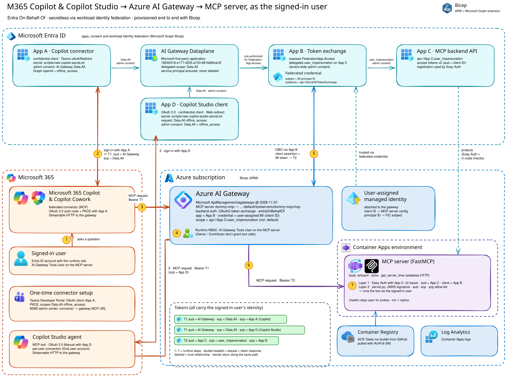
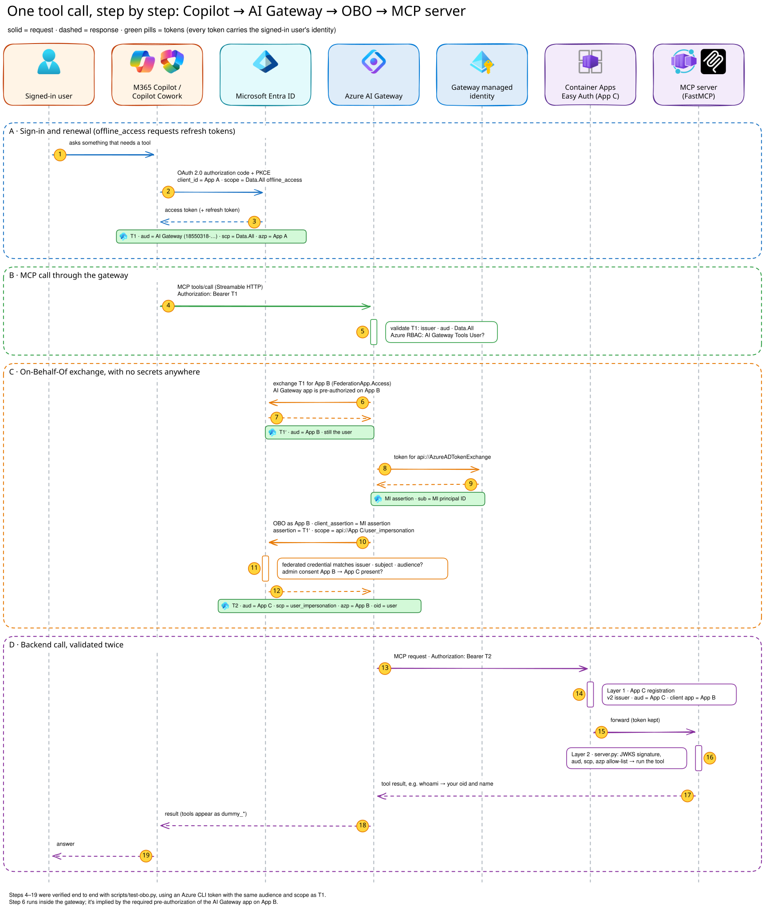

# Flow: Microsoft 365 Copilot / Copilot Cowork → Azure AI Gateway → MCP server (as the user)

The user signs in to create a connection in Copilot. Every tool call then reaches the MCP backend with a token
that carries **the user's identity** but was issued **for the backend** and requested **by the
gateway's token exchange app**. No secrets sit in the gateway: it authenticates as the token
exchange app with its user-assigned managed identity (workload identity federation).

## 1. Architecture

Numbered arrows 1–7 are the runtime path of a tool call. Teal arrows inside Microsoft Entra ID
are the consent and pre-authorization chain, and dashed arrows are trust relationships. One Bicep
deployment creates all of it, the Entra objects through the Microsoft Graph Bicep extension, except
the Copilot connector's client secret and the one-time connector setup in Microsoft 365.

## 2. One tool call, step by step

Step 6 happens inside the gateway and isn't observable from outside. It's the hop implied by the
required configuration: the gateway's first-party app must be pre-authorized for
`FederationApp.Access` on the token exchange app. Steps 4–19 were verified end to end with
`scripts/test-obo.py`: the backend received the caller's `oid`, with `aud` = App C and
`azp` = App B.

## 3. Tokens along the way

| Token | Issued to (azp) | Audience (aud) | Scope (scp) | Identity | Who validates it |
| --- | --- | --- | --- | --- | --- |
| **T1** | App A (Copilot connector) | `18550318-e177-4205-a743-6816d6fcdc3f` (AI Gateway) | `Data.All` | user | AI Gateway, then Azure RBAC |
| **T1** (Copilot Studio) | App D (Copilot Studio client) | `18550318-e177-4205-a743-6816d6fcdc3f` (AI Gateway) | `Data.All` | user | AI Gateway, then Azure RBAC |
| **T1'** | AI Gateway app | App B (token exchange) | `FederationApp.Access` | user | Entra (OBO input) |
| MI assertion | Gateway managed identity | `api://AzureADTokenExchange` | n/a | managed identity | Entra (federated credential on App B) |
| **T2** | App B (token exchange) | App C client ID (v2 tokens use the bare GUID) | `user_impersonation` | user | Easy Auth, then `server.py` |

## 4. Why each piece exists

| Piece | Without it |
| --- | --- |
| AI Gateway Dataplane service principal in the tenant | No tenant can issue `Data.All` tokens; Copilot sign-in fails. |
| App A delegated `Data.All` + admin consent | Users get consent prompts, or a "needs admin approval" block, in Copilot. |
| App D (separate client for Copilot Studio) | Copilot Studio has no client to sign users in with: it can't use Entra SSO, and Entra doesn't support Dynamic Client Registration. |
| App D admin consent | The AI Gateway is Microsoft's app, so App D can't be pre-authorized on it. Without consent, users get a consent prompt or are blocked. |
| Explicit `offline_access` in the Copilot Studio tool's OAuth scopes | Entra's v2 endpoint doesn't issue a refresh token, so the connection can't renew its access token without reauthorization. Admin consent alone doesn't request this scope. |
| App D redirect URI from Copilot Studio (Web platform) | Sign-in fails with `AADSTS50011`. Every MCP tool has its own redirect URL. |
| Runtime role **AI Gateway Tools User** | Gateway returns 403. Owner and Contributor do not grant tool invocation. |
| Pre-authorization of `18550318-…` on App B | The gateway can't obtain T1', so OBO fails. |
| App B identifier URI `api://<appId>` | The gateway can't address the token exchange app: tool calls fail with 502 and never reach the backend. |
| Federated credential (subject = MI **principal** ID) | App B can't authenticate; OBO fails. |
| Toolserver `appCredential.clientId` = MI **client** ID | The gateway picks the wrong identity. |
| App B → App C admin consent | OBO fails with a consent error (`AADSTS65001`), and the gateway returns 401. |
| Explicit backend scope (not `/.default`) | The gateway rejects the configuration. |
| App C `api.requestedAccessTokenVersion: 2` | T2 is a v1 token (`sts.windows.net` issuer, `api://` audience), so the backend rejects it. |
| Container Apps Easy Auth with App C | Invalid tokens would reach the container, leaving the in-code checks as the only gate. |
| Backend `azp` allow-list (Easy Auth `allowedApplications` + code) | Any app with a consented token for App C could call the backend directly. |
| Gateway MCP versions ⊆ backend versions | M365 Copilot proposes `2025-11-25`; mismatches show up as 502 or `-32603` on `tools/list`. |

## Editing the diagrams

The `.excalidraw` files in [`diagrams/`](diagrams/) are the editable sources, with the official
Azure, Microsoft Entra, Microsoft 365, MCP, and Bicep icons embedded. Open them in Excalidraw
(Microsoft employees: <https://aka.ms/excalidraw>, then **Open**), edit, and re-export SVG and PNG
at 2× with the background on.
